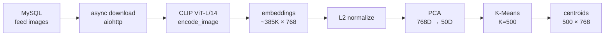
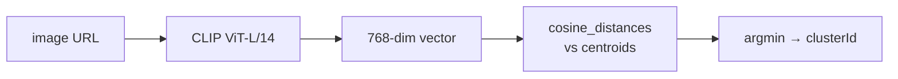

# INPOSE — AI-Driven Matching & CRM System

> Capstone project (Mar 2026 – Dec 2026) · **Team — sole AI developer** · Live service: [inpose.co](https://inpose.co/)
> Production ML pipeline for semantic feed clustering and behavior-based recommendation.

## Overview

INPOSE is the AI CRM behind the live social-matching service [*Inpose*](https://inpose.co/). The feed contains hundreds of thousands of user-posted images with no semantic labels. INPOSE automatically groups them into meaningful clusters by **visual semantics** (style, subject, composition), then learns each user's interaction history to model their taste.

The **end goal** is personalized recommendation on two surfaces: **job/recruitment posts** and the **image feed** — surfacing the postings and feeds that best match each user's inferred preferences.

The system has two halves:
1. **A clustering pipeline** that turns raw images into a fixed set of semantic clusters.
2. **A real-time inference + recommendation server** that assigns new images to clusters and computes per-user preference.

### Status & roadmap

The core ML system — semantic feed clustering, real-time inference, and user–cluster preference mapping — is **built and running in production**. In Oct–Nov 2026 I built the **feed recommendation layer** on top of it; it is validated offline and waiting to be wired into the service. Job-post recommendation is the next milestone.

| Component | Status |
|-----------|--------|
| Feed image clustering (CLIP + K-Means) | ✅ Deployed |
| Real-time cluster inference (FastAPI) | ✅ Deployed |
| User–cluster preference mapping | ✅ Deployed |
| Feed recommender (SigLIP 2 · K=1000 · LightGBM) | ✅ Offline-validated · integration pending |
| Job-post recommendation | Roadmap |

## Architecture

> The diagrams below describe the first production version (CLIP ViT-L/14, K=500). The recommender work below moves to SigLIP 2 with K=1000.

### Training pipeline

### Real-time inference

The CLIP model (~2.4s init) and centroids are loaded once at server start and reused — a singleton service pattern that brings per-request latency down to ~13 ms.

## Key design decisions

- **CLIP ViT-L/14 (768-dim)** over ViT-B variants — richer semantic representation for style/subject/composition.
- **K-Means over DBSCAN / HDBSCAN** — density-based methods failed on CLIP's high-dimensional, continuous embedding space (DBSCAN collapsed everything into 1–2 clusters or pure noise; HDBSCAN produced an unpredictable cluster count). K-Means gives a fixed cluster count, no noise points, and savable centroids — exactly what a production service needs.
- **K=500 chosen by qualitative evaluation** — standard metrics (silhouette, Davies-Bouldin) favored K≈10, which lumped ~40K images per cluster and destroyed the goal of fine-grained grouping. I instead compared K=300/500/700 on visual/semantic coherence within clusters and selected K=500 as the best balance.
- **Centroids stored in original 768-dim** — inference needs no PCA model, just `centroids.npy`, minimizing deployment dependencies.

## Results (v1, Jun 2026)

| Metric | Value |
|--------|-------|
| Training images | ~385K (now ~426K feeds in the recommender work) |
| Embedding dim | 768 (CLIP ViT-L/14) |
| Clusters | 500 |
| End-to-end inference | **~13 ms/image** |
| Throughput | **~78.8 img/s** (GPU) |
| Cluster assignment | ~1 ms |

## User preference module

Aggregates each user's `view / like / comment / scrap` interactions per cluster, applies configurable weights, and returns the top-N preferred clusters — used to drive feed and match recommendations.

## Feed recommendation layer (Oct – Nov 2026)

Goal: show each user the feeds they are most likely to **contact** the creator of — not just the ones they look at. The app currently shows a plain latest-first feed, so the recommender has to beat that.

### 1. Rebuilding the cluster foundation
- **Embedding benchmark** — extracted ~426K feeds with four models (CLIP ViT-L/14 with and without PCA, **SigLIP 2 SO400M**, DINOv2 ViT-L/14). The production model compressed embeddings to 50D with PCA, losing the fine detail (mood, face shape, styling) that matters for model photography. SigLIP 2 became the reference model.
- **K = 100 / 500 / 1000** — K=500 looked better at equal cluster count, but at an equal *fraction* of clusters the gap was not significant (28.2% vs 27.3%, 95% CI −2.4 ~ +0.6%p); the difference came from bigger clusters. Chose the finer **K=1000**.
- **Batch assignment for new feeds** — the upload-time assignment server had stopped, leaving ~250–300 new feeds/day unclustered. Wrote a batch job reusing the exact production assignment code.
- **Image cost** — routed all image loads through the CDN instead of the raw object store; downloading ~2.7K new feeds (~4.5 GB) cost about $0.50.

### 2. Defining the label from contact data
The DB never records *which feed* led to a contact. I defined it as **viewing the other user's feed within 10 minutes before the first contact** — 82% of linked contacts happened within 1 minute of the view. Only message timestamps are used, never message content.

Findings from a contact-analysis dashboard (~40K first contacts):
- Only **27.3%** of contacts link to a feed view; the rest come from profiles or job posts.
- **37%** of contacts come from clusters the user had never interacted with — pure behavior-based personalization misses a large share.
- Fixed a double-counting bug in the view-stage funnel that had inflated first-view contact rate from 5.3% to 9.0%.

### 3. Model search
**LightGBM** over (user, cluster) pairs with a per-user softmax; the target is the share of the next 14 days' contacts that land in each cluster.

| Version | Inputs | Result |
|---|---|---|
| v1 | 22 behavior / contact features | — |
| **v2** | v1 + people conditions (role, gender, pay, region/field match with creators) — 34 features | **Adopted** |
| v3 | behavior only | lower than v2 → contact data matters |
| v4 | v2 + user tendency, variable cluster count | no gain at equal average count |
| v5 | v2 + collaborative-filtering scores | no meaningful gain |

The most important feature was *the share of contacts users of the same role sent to that cluster* (30% importance), so per-role models were unnecessary. A hand-tuned tendency rule (explore vs. exploit by user type) was also built and calibrated, then retired once the model matched it without hand-set numbers.

### 4. Evaluation
All comparisons use a **time split** (predict from data before a cutoff, score on real contacts after it) with **paired bootstrap 95% CIs**. The current app is latest-first, so the ground truth is biased *toward* latest-first.

**Cluster prediction vs. latest-first** (10/1 → 10/30, ~1.5K users)

| Method | Top-20 clusters | Top-50 clusters |
|---|---|---|
| **LightGBM (contact data)** | **13.9%** | **27.3%** |
| Clusters popular with same-role users | 11.7% | 23.4% |
| Latest-first (feeds posted in period) | 7.0% | 17.1% |

**Retraining with October data** (10/31 → 11/7, ~600 users): top-20 16.4% → **18.1%**, top-50 27.9% → **30.1%** (both significant) — evidence for scheduled retraining.

**Ordering inside each cluster** (10/31 lists → actual contacts by 11/7, ~600 users)

| Feed list (500 items) | Contacts in top 100 | Contacts in top 500 | Median feed age |
|---|---|---|---|
| **Model cluster mix + latest-first inside** | **0.42** | **1.08** | 8 days |
| Model cluster mix + taste-ranked inside | 0.29 | 0.77 | 107 days |
| Current app (latest-first) | 0.30 | 0.76 | — |
| Latest-first + same exclusions | 0.33 | 0.88 | — |

Taste-ranking inside clusters kept surfacing old popular feeds; switching to latest-first fixed that and beat the current app by **+0.32 contacts per user (+42%)**. It also beat latest-first with identical exclusion rules (+0.20), isolating the effect of the model's cluster mix.

**Tried and rejected:** reserving 20–40% of slots for unseen clusters (no gain / worse), 30 or 100 clusters instead of 50 (worse / not significant).

### Final design
The model scores all 1,000 clusters for each user → the top 50 clusters split 500 feed slots by predicted share → each cluster is filled with its newest feeds (max 2 per creator, excluding already-seen feeds and already-contacted users).

## My role

Sole AI developer on the capstone team. Designed and implemented the full ML system **single-handedly** — embedding extraction, the algorithm-selection study, the clustering pipeline, the real-time inference server (FastAPI), the user-affinity mapping module, and its production deployment — and then the feed recommendation layer: label design from contact logs, embedding/K benchmarks, LightGBM modeling, and the time-split evaluation framework.

## Tech stack

`Python` · `PyTorch` · `OpenAI CLIP (ViT-L/14)` · `SigLIP 2` · `DINOv2` · `LightGBM` · `scikit-learn (KMeans, PCA)` · `FastAPI` · `MySQL` · `aiohttp` · `CUDA`
